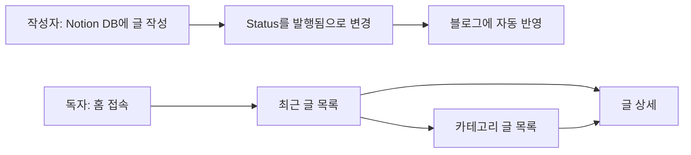

# 개인 개발 블로그 PRD (Notion CMS)

> 작성 기준: `docs/PRD_PROMPT.md`의 13개 섹션 구조 + 프로젝트 명세(개인 개발 블로그)
> 스택 기준: `CLAUDE.md` (Next.js 15.5.3, React 19, TypeScript 5, TailwindCSS v4, shadcn/ui)

## 1. 개요

- **프로젝트명**: 개인 개발 블로그
- **한 줄 요약**: Notion에서 글을 쓰면 자동으로 반영되는 개인 기술 블로그
- **배경**: 별도 관리자 화면이나 DB 없이, 평소 쓰는 Notion을 CMS로 삼아 글 작성과 발행 부담을 줄인다.

## 2. 목표와 성공 지표

| 목표                             | 성공 기준                                                              |
| -------------------------------- | ---------------------------------------------------------------------- |
| Notion 작성 → 블로그 반영 자동화 | `Status`를 `발행됨`으로 바꾸면 코드 수정·재배포 없이 블로그에 노출된다 |
| 읽기 쉬운 글 목록/상세           | 홈에서 글 클릭 후 상세 본문까지 2클릭 이내 도달                        |
| 모든 기기에서 사용 가능          | 모바일(360px)~데스크톱에서 가로 스크롤 없이 표시                       |

## 3. 사용자

| 구분                | 설명                                 | 니즈                           |
| ------------------- | ------------------------------------ | ------------------------------ |
| 작성자(블로그 주인) | Notion에서 글을 작성·발행하는 개발자 | 글 작성 외 추가 작업 없이 반영 |
| 독자                | 링크나 검색으로 방문하는 개발자      | 최신 글 탐색, 가독성 좋은 본문 |

## 4. 사용자 여정



## 5. 기능 요구사항

| ID     | 기능명            | 설명                                                                        | 범위                 | 인수 조건                                                                      |
| ------ | ----------------- | --------------------------------------------------------------------------- | -------------------- | ------------------------------------------------------------------------------ |
| FR-001 | Notion 연동       | `@notionhq/client`로 Notion DB를 조회한다 (서버 사이드, API 키는 환경 변수) | MVP                  | 환경 변수 설정 후 DB 글이 조회된다. API 키가 클라이언트 번들에 포함되지 않는다 |
| FR-002 | 글 목록           | `Status = 발행됨`인 글을 `Published` 최신순으로 표시한다                    | MVP                  | 초안 글은 노출되지 않고, 목록이 발행일 내림차순이다                            |
| FR-003 | 글 상세           | 개별 글의 제목·카테고리·태그·발행일·본문을 표시한다                         | MVP                  | 목록의 글 클릭 시 해당 글 본문이 표시된다. 없는 글은 404 처리된다              |
| FR-004 | 반응형 디자인     | 모바일/태블릿/데스크톱 레이아웃 대응                                        | MVP                  | 360px, 768px, 1280px 폭에서 레이아웃이 깨지지 않는다                           |
| FR-005 | 기본 스타일링     | Tailwind CSS + shadcn/ui 기반 기본 UI (다크모드 지원)                       | MVP                  | 라이트/다크 테마 모두에서 텍스트 가독성이 유지된다                             |
| FR-006 | 카테고리별 필터링 | 카테고리별 글 목록을 표시한다                                               | MVP 이후 (확인 필요) | 선택한 카테고리의 글만 표시된다                                                |
| FR-007 | 검색              | 키워드로 글을 검색한다                                                      | MVP 이후             | 입력한 키워드가 제목에 포함된 글이 표시된다                                    |

> 카테고리 필터링과 검색은 "주요 기능"에는 있으나 "MVP 범위"에는 없어 MVP 이후로 분류했다. 화면 구성에는 카테고리 화면이 있으므로 6절 미결정 사항에서 확정한다.

## 6. Notion 데이터 모델

| 속성      | 표시명   | Notion 타입  | 필수 | 비고                 |
| --------- | -------- | ------------ | ---- | -------------------- |
| Title     | 제목     | title        | ✅   |                      |
| Category  | 카테고리 | select       | ✅   | 카테고리 필터링 기준 |
| Tags      | 태그     | multi_select |      |                      |
| Published | 발행일   | date         | ✅   | 목록 정렬 기준       |
| Status    | 상태     | select       | ✅   | `초안` / `발행됨`    |
| Content   | 본문     | page content | ✅   | 페이지 본문 블록     |

- `Status = 발행됨`인 글만 블로그에 노출한다.
- 본문 블록 렌더링 방식은 미정이다 (11절 참고).

```ts
// Notion 응답 검증용 Zod 스키마 초안
import { z } from 'zod'

export const postSchema = z.object({
  id: z.string(),
  title: z.string(),
  category: z.string(),
  tags: z.array(z.string()),
  published: z.string(), // ISO 날짜
  status: z.enum(['초안', '발행됨']),
})
```

## 7. 화면 설계

| 화면     | 경로(`app/`)       | 구성                                        | 구현 기능                      |
| -------- | ------------------ | ------------------------------------------- | ------------------------------ |
| 홈       | `/`                | 최근 글 목록 (제목, 카테고리, 태그, 발행일) | FR-001, FR-002, FR-004, FR-005 |
| 글 상세  | `/posts/[id]`      | 제목, 메타 정보, 본문                       | FR-001, FR-003, FR-004, FR-005 |
| 카테고리 | `/category/[name]` | 카테고리별 글 목록                          | FR-006 (MVP 이후 확인 필요)    |

- 공통 상태: 로딩, 글 없음(빈 상태), 오류, 404
- 재사용 shadcn/ui: Card, Badge, Skeleton, Button (기존 `src/components/ui` 활용)

## 8. 기술 설계

| 구분       | 기술                                           |
| ---------- | ---------------------------------------------- |
| Frontend   | Next.js 15 (App Router, Turbopack), TypeScript |
| CMS        | Notion API (`@notionhq/client`)                |
| Styling    | Tailwind CSS, shadcn/ui                        |
| Icons      | Lucide React                                   |
| Deployment | Vercel                                         |

- Server Components에서 Notion을 호출하고 결과만 클라이언트로 전달한다.
- 환경 변수: `NOTION_API_KEY`, `NOTION_DATABASE_ID` (`.env.example` 제공, 실제 값은 커밋하지 않음)
- 캐싱·재검증 전략(ISR `revalidate` 등)은 "Notion 수정이 블로그에 반영되는 시간"에 직결되므로 3단계에서 확정한다.

## 9. 비기능 요구사항

- API 키가 클라이언트에 노출되지 않는다.
- 모바일~데스크톱 반응형, 다크모드 대응
- Notion API 호출 실패 시 오류 화면을 보여주고 서버가 중단되지 않는다.

## 10. 리스크 및 가정

| 항목                 | 내용                                                                | 대응                                                 |
| -------------------- | ------------------------------------------------------------------- | ---------------------------------------------------- |
| Notion API 호출 제한 | 요청이 많으면 제한에 걸릴 수 있음 (가정: 개인 블로그 트래픽은 낮음) | 캐싱/재검증 적용                                     |
| 반영 지연            | 캐싱 시 Notion 수정이 즉시 반영되지 않음                            | 재검증 주기 설정                                     |
| 본문 렌더링          | Notion 블록 타입이 다양해 일부 미지원 가능                          | MVP는 주요 블록(문단, 제목, 코드, 목록, 이미지) 우선 |

## 11. 구현 단계

1. Notion API 패키지 설치 및 환경 설정
2. Notion 데이터베이스 생성 및 API 키 설정
3. 글 목록 페이지 구현
4. 글 상세 페이지 구현
5. 스타일링 및 최적화

## 12. 향후 확장

- 카테고리별 필터링 (MVP 포함 여부 확정 시 이동)
- 검색
- 태그별 목록, RSS, SEO 메타데이터

## 13. 미결정 사항

1. 카테고리 화면·필터링(FR-006)을 MVP에 포함할 것인가?
2. Notion 본문 블록 렌더링 방식 (직접 변환 vs 라이브러리)
3. 글 상세 경로에 `id` 대신 slug를 쓸 것인가? (Notion DB에 Slug 속성 없음)
4. 캐싱/재검증 주기
